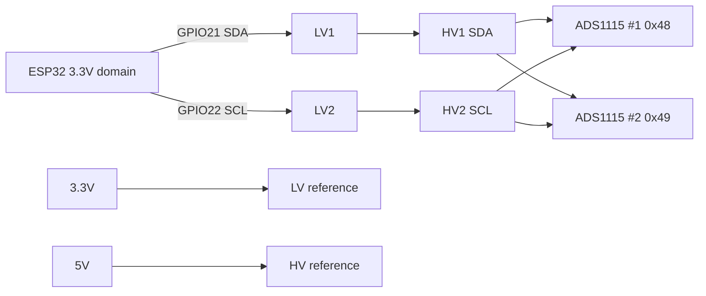
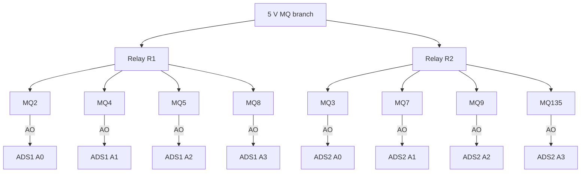
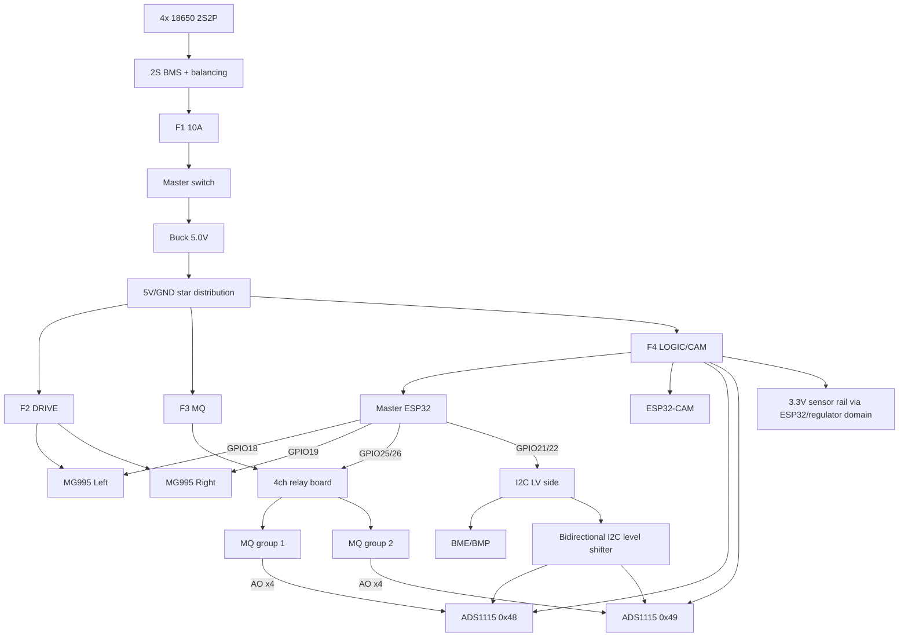

# HazRob 0.8 — Complete Wiring, Power & Protection Guide

> **Status:** Field wiring baseline for HazRob 0.8  
> **Applies to:** DOIT ESP32 DEVKIT V1 master + AI-Thinker ESP32-CAM + 8× MQ + 2× ADS1115 + 4-channel active-LOW relay module + BME/BMP + MAX4466 + IR + 2× continuous MG995  
> **Primary sources of truth:** `firmware/HazRob/Config.h`, `firmware/HazRob/Hardware.cpp`, `app/src/main/java/com/servoc/app/hardware/HazRobHardwareProfile.java`, `firmware/HazRob-CAM/HazRob-CAM.ino`.

## 1. Safety and wiring rules

1. **Never power the robot while adding/removing wires.** Disconnect the battery pack first.
2. All low-voltage electronics share **one common GND**, but high-current returns must go to the power-distribution/star-ground point, not through the ESP32 board.
3. Never feed 5 V into an ESP32 GPIO. ESP32 logic is 3.3 V.
4. MQ analog outputs go to ADS1115 only; they do not connect directly to ESP32 ADC pins.
5. The two ADS1115 boards run in the 5 V domain and share the I2C bus through a bidirectional level shifter.
6. Servo and MQ heater current must not pass through the ESP32 regulator or thin Dupont power wires.
7. The battery pack must use matched cells and a proper 2S BMS with balancing.
8. The guide assumes a **5 V active-LOW relay board**. If the physical relay board is marked 12 V, stop and do not connect its VCC/JD-VCC to the 5 V rail.
9. Before first power-up, use continuity mode to verify there is no short between +5 V and GND, +3.3 V and GND, or battery + and battery -.
10. Label both ends of every wire even when a color code is used.

---

## 2. Ten-color wiring standard

Use the following 10 colors throughout the robot. Do not change a color's meaning in another subsystem.

| Color | Function | Typical gauge |
|---|---|---|
| **Brown** | Raw battery/BMS voltage: 6.0–8.4 V | 18–20 AWG |
| **Red** | Regulated +5 V power | 18–22 AWG depending on load |
| **Black** | GND / return | 18–22 AWG power, 24–26 AWG signal return |
| **Yellow** | +3.3 V logic/sensor power | 24–26 AWG |
| **Blue** | I2C SDA | 24–26 AWG |
| **White** | I2C SCL | 24–26 AWG |
| **Green** | Analog sensor signal / MQ AO | 24–26 AWG |
| **Orange** | Relay control GPIO | 24–26 AWG |
| **Purple** | Servo PWM/control signal | 24–26 AWG |
| **Gray** | Digital sensor outputs / auxiliary logic | 24–26 AWG |

**Mandatory labels for repeated colors:** `MQ2-AO`, `MQ4-AO`, `MQ5-AO`, `MQ8-AO`, `MQ3-AO`, `MQ7-AO`, `MQ9-AO`, `MQ135-AO`, `R1-IN`, `R2-IN`, `SERVO-L`, `SERVO-R`, etc.

---

## 3. System power architecture

### 3.1 Battery pack

Recommended baseline:

- 4 matched 18650 Li-ion cells.
- Connection: **2S2P**.
- Nominal pack: **7.4 V**.
- Fully charged: **8.4 V**.
- Use cells of the same chemistry, model, capacity, age and state of health.
- Do not mix 2000 mAh and 3000 mAh cells in the same pack.
- **2S BMS with balancing, ≥10 A continuous; 15 A preferred.**

### 3.2 Main protection and converter

Recommended chain:

```text
2S2P battery
   │
   ▼
2S BMS with balancing
   │
   ▼
F1 MAIN FUSE 10 A
   │
   ▼
Master DC switch ≥10 A
   │
   ▼
Buck converter 6.0–8.4 V → 5.0 V
   │   Minimum target: 5 V / 6 A continuous
   │   Preferred transient margin: 8–10 A class converter
   ▼
5 V star power distribution
```

**F1 must be physically close to the pack/BMS positive output.**

### 3.3 Recommended converter capacitors

If not already adequately fitted on the converter module:

- Converter input: **470 µF / 16 V electrolytic + 100 nF ceramic** across VIN/GND.
- Converter output/star point: **2200 µF / 10 V low-ESR electrolytic + 100 nF ceramic** across 5 V/GND.

Observe electrolytic capacitor polarity.

### 3.4 5 V branch protection

Use a star topology from the 5 V distribution point.

| Branch | Recommended fuse | Loads |
|---|---:|---|
| F2 DRIVE | 5 A slow-blow / blade, validate under stall tests | 2× MG995 servos |
| F3 MQ | 3 A | 8× MQ heater modules + relay contact feed |
| F4 LOGIC/CAM | 2 A | Master ESP32, ADS, environment, sound, IR, ESP32-CAM, relay electronics |

If the installed buck converter is truly limited to 6 A continuous, verify all three branches under worst-case simultaneous load and check 5 V rail sag before field use.

### 3.5 Star-ground rule

```text
                         ┌─ Servo GND
                         ├─ MQ GND
Buck 5 V GND / STAR  ────┼─ Relay GND
                         ├─ ADS GND
                         ├─ ESP32 GND
                         ├─ ESP32-CAM GND
                         └─ Sensor GND
```

Do **not** route servo return current through an ESP32 GND pin before reaching the star point.

---

## 4. Master ESP32 pin map — HazRob 0.8

| ESP32 pin | Name/function | Wire color | Destination |
|---:|---|---|---|
| GPIO18 | `SERVO_L` | Purple | Left continuous MG995 signal |
| GPIO19 | `SERVO_R` | Purple | Right continuous MG995 signal |
| GPIO21 | `SDA` | Blue | LV-side SDA / BME-BMP SDA |
| GPIO22 | `SCL` | White | LV-side SCL / BME-BMP SCL |
| GPIO25 | `RELAY1` | Orange | Relay IN1 — MQ group 1 |
| GPIO26 | `RELAY2` | Orange | Relay IN2 — MQ group 2 |
| GPIO27 | `RELAY3` | Orange | Reserved in current 0.8 topology |
| GPIO32 | `RELAY4` | Orange | Reserved in current 0.8 topology |
| GPIO36 | `SOUND_PIN` | Green | MAX4466 OUT |
| GPIO35 | `IR_PIN` | Gray | IR digital warning output |
| GPIO34 | AUX/LDR | Gray | Reserved; digital LDR is not yet consumed by current `Hardware.cpp` telemetry |
| GPIO33 | AUX1 | Gray | Spare input |
| GPIO39 | AUX3 | Gray | Spare input |
| GPIO23 | future peripheral | Gray | Reserved, e.g. future HC-SR04 TRIG |
| 3V3 | +3.3 V | Yellow | LV logic/sensors only |
| 5V/VIN | +5 V | Red | Master ESP32 power from regulated 5 V rail |
| GND | Ground | Black | Star ground |

**GPIO34/35/36/39 are input-only on ESP32; do not use them as outputs.**

---

## 5. I2C level shifter and bus topology

Use **one 4-channel bidirectional logic-level converter** for the I2C bus. Only channels 1 and 2 are required.

### 5.1 Level-shifter wiring

| Level-shifter pin | Connection | Color |
|---|---|---|
| LV | ESP32 3V3 | Yellow |
| LV GND | Common GND | Black |
| LV1 | ESP32 GPIO21 / SDA | Blue |
| LV2 | ESP32 GPIO22 / SCL | White |
| LV3/LV4 | Spare | — |
| HV | 5 V rail | Red |
| HV GND | Common GND | Black |
| HV1 | ADS1 + ADS2 SDA | Blue |
| HV2 | ADS1 + ADS2 SCL | White |
| HV3/HV4 | Spare / optional digital level translation | — |



### 5.2 I2C pull-ups

The common BSS138 level-shifter boards and many ADS/BME breakout boards already include pull-up resistors. **Do not add extra pull-ups by default.** If bus rise time or reliability is poor, measure the effective pull-up first; only then consider approximately 4.7 kΩ on the affected side.

---

## 6. ADS1115 wiring

Both ADS1115 boards are powered from the **5 V rail** and are configured in firmware with `GAIN_TWOTHIRDS`.

### ADS1115 #1

| ADS1 pin | Connection |
|---|---|
| VDD | +5 V |
| GND | GND |
| SDA | Level shifter HV1 |
| SCL | Level shifter HV2 |
| ADDR | GND → I2C address **0x48** |
| ALRT | Not connected |
| A0 | MQ2 AO |
| A1 | MQ4 AO |
| A2 | MQ5 AO |
| A3 | MQ8 AO |

### ADS1115 #2

| ADS2 pin | Connection |
|---|---|
| VDD | +5 V |
| GND | GND |
| SDA | Level shifter HV1 |
| SCL | Level shifter HV2 |
| ADDR | VDD/5 V → I2C address **0x49** |
| ALRT | Not connected |
| A0 | MQ3 AO |
| A1 | MQ7 AO |
| A2 | MQ9 AO |
| A3 | MQ135 AO |

### Optional analog-input protection/filtering

For each MQ AO line, if field testing shows wiring noise, use an optional slow-sensor RC filter close to the ADS input:

```text
MQ AO ── 1 kΩ ──► ADS Ax
                 │
               100 nF
                 │
                GND
```

Because MQ response is slow, this filter normally has negligible effect on steady-state concentration measurements, but calibration should be verified after any analog-path change.

Never allow ADS analog input to exceed its supply rail.

---

## 7. MQ sensor map and relay groups

HazRob 0.8 uses **two installed MQ power groups**. R3 and R4 remain reserved.

### Group 1 — Relay R1 / GPIO25 / ADS1 0x48

| Sensor | Power | Analog signal |
|---|---|---|
| MQ2 | +5 V through Relay R1 | AO → ADS1 A0 |
| MQ4 | +5 V through Relay R1 | AO → ADS1 A1 |
| MQ5 | +5 V through Relay R1 | AO → ADS1 A2 |
| MQ8 | +5 V through Relay R1 | AO → ADS1 A3 |

### Group 2 — Relay R2 / GPIO26 / ADS2 0x49

| Sensor | Power | Analog signal |
|---|---|---|
| MQ3 | +5 V through Relay R2 | AO → ADS2 A0 |
| MQ7 | +5 V through Relay R2 | AO → ADS2 A1 |
| MQ9 | +5 V through Relay R2 | AO → ADS2 A2 |
| MQ135 | +5 V through Relay R2 | AO → ADS2 A3 |

All MQ **GND pins remain permanently connected to common GND**. Do not switch their grounds with the relay. `DO` pins are unused.



### Simultaneous operation

`R1 + R2` may be ON together, allowing all eight MQ modules to operate simultaneously. The battery/buck/power-distribution system must be validated under this condition together with servo and camera load.

---

## 8. Relay module wiring

### 8.1 Control side

Assuming a 5 V, 4-channel, active-LOW module:

| Relay input | ESP32 | Color |
|---|---:|---|
| IN1 | GPIO25 | Orange |
| IN2 | GPIO26 | Orange |
| IN3 | GPIO27 | Orange |
| IN4 | GPIO32 | Orange |
| VCC | 5 V logic/relay supply | Red |
| GND | Common GND | Black |

Recommended: **1 kΩ series resistor** in each ESP32→IN line. This limits accidental current during faults without normally affecting a logic input.

Before connecting ESP32 GPIOs, power the relay board by itself and measure each IN pin relative to GND. If an unconnected IN pin is pulled above 3.3 V, do not connect it directly to ESP32; use a transistor/opto interface or a suitable level-shifting stage.

### 8.2 Contact side for MQ power

For R1:

```text
5 V MQ branch ─► COM1
NO1 ─► +5 V feed shared by MQ2 + MQ4 + MQ5 + MQ8
NC1 unused
```

For R2:

```text
5 V MQ branch ─► COM2
NO2 ─► +5 V feed shared by MQ3 + MQ7 + MQ9 + MQ135
NC2 unused
```

Using NO ensures MQ heaters are OFF when the relay is unpowered.

R3/R4 contact sets remain reserved in HazRob 0.8.

---

## 9. MG995 continuous-rotation drive servos

### Left servo

- Signal: ESP32 **GPIO18** — Purple.
- Power: +5 V high-current branch — Red.
- Ground: star-ground branch — Black.

### Right servo

- Signal: ESP32 **GPIO19** — Purple.
- Power: +5 V high-current branch — Red.
- Ground: star-ground branch — Black.

### Drive decoupling

At the servo distribution point:

- **2200 µF / 10 V low-ESR electrolytic** across 5 V/GND.
- **100 nF ceramic** across 5 V/GND.

If servo leads are long, add **470 µF / 10 V** near each servo connector.

Do not power either MG995 from the ESP32 5 V/VIN pin trace.

---

## 10. BME280/BMP280 environmental sensor

The environment sensor stays on the **3.3 V / LV I2C side**.

| Sensor pin | Connection | Color |
|---|---|---|
| VCC/VIN | ESP32 3V3 | Yellow |
| GND | GND | Black |
| SDA | GPIO21 / LV SDA | Blue |
| SCL | GPIO22 / LV SCL | White |

Firmware probes addresses **0x76** and **0x77** automatically.

Recommended local decoupling: **100 nF ceramic + 10 µF electrolytic/ceramic** across 3.3 V/GND near the sensor if wiring is long.

---

## 11. MAX4466 microphone module

| MAX4466 pin | Connection | Color |
|---|---|---|
| VCC | 3.3 V | Yellow |
| GND | GND | Black |
| OUT | ESP32 GPIO36 | Green |

Recommended supply decoupling close to the module:

- 100 nF ceramic across VCC/GND.
- 10 µF capacitor across VCC/GND.

Do not place a large capacitor on the audio OUT line unless intentionally redesigning the bandwidth; firmware derives RMS and peak-to-peak from the waveform.

---

## 12. IR obstacle/proximity digital sensor

Firmware input: **GPIO35**, active LOW, warning/telemetry only.

Preferred connection if the module operates correctly at 3.3 V:

| IR pin | Connection | Color |
|---|---|---|
| VCC | 3.3 V | Yellow |
| GND | GND | Black |
| DO/OUT | GPIO35 | Gray |

If the module must run at 5 V, **measure its output first**. If HIGH is near 5 V, translate it before GPIO35 using spare level-shifter channel LV3/HV3 or a divider such as:

```text
IR OUT 5 V ── 10 kΩ ──┬──► GPIO35
                       │
                      20 kΩ
                       │
                      GND
```

Do not feed a 5 V digital HIGH directly to GPIO35.

---

## 13. Digital LDR / LM393 module

HazRob 0.8 documentation reserves **GPIO34** for a digital light-threshold module, but current `firmware/HazRob/Hardware.cpp` does not yet consume this signal in telemetry. Treat this as a **wired-but-reserved** input until firmware support is explicitly enabled.

If fitted:

- OUT/DO → GPIO34 — Gray.
- GND → common GND — Black.
- Prefer 3.3 V supply if the module works reliably at 3.3 V.
- If powered from 5 V and DO goes to 5 V, use level translation/divider before GPIO34.

---

## 14. ESP32-CAM subsystem

The AI-Thinker ESP32-CAM is a separate Wi-Fi node; it does not need a data wire to the master ESP32.

- +5 V regulated rail → ESP32-CAM **5V** pin — Red.
- GND → common star ground — Black.
- Recommended local bulk capacitor: **470–1000 µF / 10 V** across 5 V/GND near the camera board.
- Recommended local 100 nF ceramic across 5 V/GND.
- Camera firmware uses static IP `192.168.4.2`; master is `192.168.4.1`.
- Onboard flash is controlled by camera firmware using GPIO4 internally.

Keep servo/MQ high-current wiring physically separated from the camera antenna and camera ribbon cable.

---

## 15. Complete topology



---

## 16. Power-on inspection sequence

Perform the first bring-up in this exact order.

### Stage A — unpowered continuity

1. Battery disconnected.
2. Verify no continuity/short between 5 V and GND.
3. Verify no continuity/short between 3.3 V and GND.
4. Verify level shifter HV and LV are not shorted together.
5. Verify all grounds are common.
6. Verify polarity of all electrolytic capacitors.

### Stage B — power supply only

1. Disconnect ESP32 and all sensors.
2. Connect battery/BMS/buck only.
3. Set buck output to **5.00 V** before attaching electronics.
4. Verify output under a test load if available.

### Stage C — master + I2C backbone

Connect only:

- Master ESP32.
- I2C level shifter.
- ADS1115 #1.
- ADS1115 #2.
- BME/BMP.

Expected HazRob diagnostics:

- ADS1 present at 0x48.
- ADS2 present at 0x49.
- Environment sensor at 0x76 or 0x77 if installed.

### Stage D — low-current sensors

Add MAX4466, IR, then optional LDR. Confirm telemetry before adding MQ heaters or drive servos.

### Stage E — MQ channels

Connect MQ AO lines first, verify each channel identity, then connect R1/R2-switched 5 V heater feeds. Test R1 only, then R2 only, then R1+R2.

### Stage F — drive

Connect servo signals and servo power last. Lift tracks/wheels off the ground for the first drive test. Verify neutral trims before field operation.

---

## 17. Voltage checkpoints

Measure with a multimeter and record before field deployment:

| Point | Expected |
|---|---|
| Fully charged 2S battery | about 8.4 V |
| Buck output idle | 5.00 V nominal |
| Buck output with all MQ ON | close to 5 V; investigate material sag |
| Buck output with MQ + camera + servo movement | close to 5 V; no ESP32 brownout |
| ESP32 3V3 | about 3.3 V |
| Level shifter LV | about 3.3 V |
| Level shifter HV | about 5 V |
| ADS1 ADDR | GND |
| ADS2 ADDR | 5 V |
| ESP32 digital inputs | never >3.3 V |

---

## 18. Connector and harness labels

Recommended harness names:

- `PWR-BAT`
- `PWR-5V-MAIN`
- `PWR-SERVO`
- `PWR-MQ-R1`
- `PWR-MQ-R2`
- `I2C-LV`
- `I2C-HV`
- `ADS1-0x48`
- `ADS2-0x49`
- `MQ2-AO`, `MQ4-AO`, `MQ5-AO`, `MQ8-AO`
- `MQ3-AO`, `MQ7-AO`, `MQ9-AO`, `MQ135-AO`
- `SERVO-L-G18`
- `SERVO-R-G19`
- `RELAY1-G25`
- `RELAY2-G26`
- `SOUND-G36`
- `IR-G35`
- `LDR-G34-RESERVED`
- `CAM-5V`

Use heat-shrink labels or printed tags on **both ends** of every harness.

---

## 19. Current HazRob 0.8 wiring authority

When documentation conflicts, use this precedence:

1. `firmware/HazRob/Config.h`
2. `app/src/main/java/com/servoc/app/hardware/HazRobHardwareProfile.java`
3. `firmware/HazRob/Hardware.cpp`
4. This wiring guide
5. Older README tables / archived firmware

Current authoritative MQ topology is:

```text
R1 / GPIO25 / ADS1 0x48: MQ2, MQ4, MQ5, MQ8
R2 / GPIO26 / ADS2 0x49: MQ3, MQ7, MQ9, MQ135
R3 / GPIO27: reserved
R4 / GPIO32: reserved
```

Both installed groups may be powered simultaneously.

---

## 20. Items that require physical verification before final harness lock-down

The following are intentionally not assumed from photographs alone:

- Exact relay-board coil/input voltage and whether it has separate JD-VCC/VCC rails.
- Actual continuous and stall current of the two installed continuous-rotation MG995 units.
- Actual continuous-current rating and thermal performance of the installed buck converter.
- Actual high-level voltage of the IR and LDR digital modules when powered from their chosen supply.
- Actual 18650 cell discharge capability and capacity.

Do not permanently bundle or heat-shrink the final harness until these measurements have passed.

---

## 21. Final pre-field checklist

- [ ] 2S2P cells matched and secured.
- [ ] 2S balancing BMS installed.
- [ ] F1 main fuse installed close to pack.
- [ ] Master switch installed.
- [ ] Buck adjusted to 5.00 V before electronics connection.
- [ ] Star-ground distribution implemented.
- [ ] Servo power bypasses ESP32 regulator/PCB traces.
- [ ] 2200 µF bulk capacitor fitted on servo/5 V distribution.
- [ ] ADS1 address verified as 0x48.
- [ ] ADS2 address verified as 0x49.
- [ ] I2C level shifter LV=3.3 V and HV=5 V.
- [ ] MQ mapping verified channel-by-channel.
- [ ] R1 powers only MQ2/MQ4/MQ5/MQ8.
- [ ] R2 powers only MQ3/MQ7/MQ9/MQ135.
- [ ] R1+R2 simultaneous operation tested under load.
- [ ] No 5 V digital signal reaches ESP32 GPIO.
- [ ] MAX4466 OUT verified on GPIO36.
- [ ] IR verified on GPIO35.
- [ ] Servo neutral values verified with tracks/wheels lifted.
- [ ] Camera stable at 192.168.4.2 while drive and MQ loads are active.
- [ ] 5 V rail measured during worst-case simultaneous operation.
- [ ] Every wire labeled at both ends.

This document is the field-wiring baseline for HazRob 0.8 and should be updated whenever the physical hardware profile, GPIO map, power architecture, relay grouping, or sensor inventory changes.
